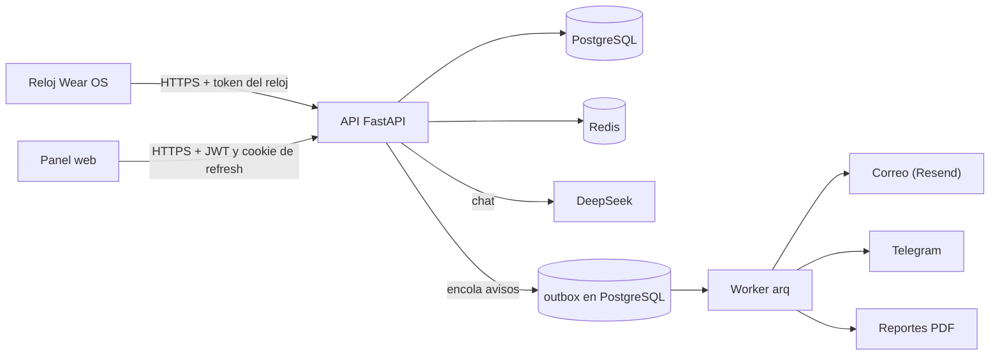

<div align="center">

# Recuerda · back-smartwatch

**API de recordatorios de medicamentos para un reloj Wear OS y un panel web.**


</div>

## Contenido

1. [Qué es](#qué-es)
2. [Cómo está compuesto](#cómo-está-compuesto)
3. [Cómo funciona](#cómo-funciona)
4. [La API](#la-api)
5. [Estructura del código](#estructura-del-código)
6. [Ejecutar en local](#ejecutar-en-local)
7. [Pruebas y CI](#pruebas-y-ci)
8. [Despliegue](#despliegue)

## Qué es

Recuerda ayuda a una persona a tomar su medicación a tiempo y permite que sus cuidadores lo sigan. Tiene tres partes:

| Parte | Repositorio | Qué hace |
| --- | --- | --- |
| **Reloj Wear OS** | [front-smartwatch](https://github.com/StehvenObandoUcc/front-smartwatch) (`wear/`) | App independiente, sin app de teléfono. Suena a la hora de cada dosis, registra si se tomó, se pospuso o se omitió, y tiene un asistente por voz. Funciona sin conexión con el plan de 7 días descargado. El APK está en sus [releases](https://github.com/StehvenObandoUcc/front-smartwatch/releases/latest). |
| **Panel web** | [front-smartwatch](https://github.com/StehvenObandoUcc/front-smartwatch) (`web/`) | El paciente o su cuidador carga medicamentos y horarios, vincula el reloj, consulta la adherencia, descarga reportes y configura los avisos. |
| **Backend** | este repositorio | API REST que guarda todo, genera el plan de dosis, envía avisos por correo y Telegram, crea reportes PDF y conecta el asistente de IA. |

La interfaz está en español o inglés, según el idioma de la cuenta (`locale`).

## Cómo está compuesto



| Pieza | Tecnología | Para qué |
| --- | --- | --- |
| API | Python 3.13, FastAPI, Pydantic v2 | Endpoints REST, validación y errores `application/problem+json` (RFC 9457) |
| Base de datos | PostgreSQL 17, SQLAlchemy 2 async, Alembic | Cuentas, pacientes, medicamentos, tomas, reportes, outbox y registro de accesos |
| Redis | Redis 7 | Límites de peticiones, propuestas pendientes del asistente y cola del worker |
| Worker | arq | Entrega de avisos, alertas de dosis omitida y reportes |
| Asistente | DeepSeek con el SDK `openai` | Chat sobre el plan del paciente |
| Seguridad | PyJWT, Argon2 | Tokens de acceso de 15 min, refresh rotativo y revocable, contraseñas con hash |
| Reportes | fpdf2 | PDF del reporte semanal |
| Dependencias | uv | Entorno y bloqueo de versiones (`uv.lock`) |

## Cómo funciona

### 1. Cuentas, pacientes y cuidadores

- Cada cuenta tiene un rol: **paciente** (tiene su propio registro de paciente) o **cuidador** (crea pacientes gestionados o se une a uno con una invitación).
- Un cuidador solo ve los pacientes con los que tiene un vínculo activo.
- Antes de procesar datos se comprueban los consentimientos: `health_data` (datos de salud), `ai_chat` (asistente) y `notifications` (avisos).
- Cada acceso con éxito a datos de salud queda en un registro de accesos.
- `DELETE /users/me` borra la cuenta y sus datos de salud en una sola transacción.

### 2. Vincular el reloj (sin teclado)

1. El reloj pide un código corto (`POST /devices/pairing-codes`) y lo muestra en pantalla.
2. En el panel web, el usuario escribe ese código y elige el paciente (`POST /devices/pairing-codes/{code}/confirm`).
3. El reloj consulta hasta recibir sus tokens (`POST /devices/token`). Desde ahí actúa en nombre de ese paciente.

### 3. Medicamentos y plan de dosis

- Un medicamento tiene uno o varios horarios: horas del día (`08:00`) × días de la semana, entre una fecha de inicio y otra opcional de fin.
- El backend genera el **plan de 7 días** con la zona horaria del paciente. Cada cambio de medicamentos u horarios sube la versión del plan.
- El reloj descarga el plan con `GET /devices/me/plan` usando `ETag`: si nada cambió, recibe `304` y no gasta datos.

### 4. Registrar tomas

1. A la hora de la dosis el reloj suena. El paciente pulsa *Tomada*, *Posponer* u *Omitir*.
2. El reloj guarda el evento con un `eventId` propio y lo envía en lote (`POST /devices/me/dose-events`) cuando tiene conexión.
3. El backend comprueba que la dosis exista en el plan. Reenviar el mismo evento no lo duplica: cada evento responde `created`, `duplicate` o `rejected`.
4. Una dosis sin registrar más de 60 minutos después de su hora cuenta como **no registrada** (`MISSED`).
5. Una toma se puede deshacer desde el reloj o desde la web, y la web también puede registrar tomas.

La **adherencia** es tomadas ÷ (tomadas + omitidas + no registradas). Se consulta por rango de fechas.

### 5. Avisos y reportes

Nada lento se hace dentro de una petición. La API escribe el mensaje en la tabla **outbox** y el **worker** lo entrega con reintentos:

| Tarea del worker | Cada cuánto |
| --- | --- |
| Entregar el outbox (correo y Telegram) | 15 s |
| Buscar dosis no registradas y avisar a los cuidadores | 1 min |
| Generar los PDF pendientes | 10 s |
| Crear el reporte semanal | El lunes a las 08:00 de cada paciente |

- **Correo**: verificación de cuenta, recuperación de contraseña, alertas y reportes.
- **Telegram**: el usuario vincula su chat con el bot desde el panel y elige qué avisos recibir y por qué canal.
- Los avisos salen en el idioma de quien los recibe.

Si el worker está detenido, la API sigue funcionando y los avisos esperan en el outbox.

### 6. Asistente con IA

- **Web**: el asistente responde por *streaming* (SSE) sobre el plan del paciente.
- **Reloj**: respuesta corta (máximo 40 palabras) para leerla en voz alta.
  - El asistente puede **proponer** agregar un medicamento o una hora a uno que ya existe.
  - Nada se crea hasta que el usuario lo confirma en el reloj.
- **Reglas fijas del asistente**:
  - No cambia dosis.
  - No diagnostica.
  - Responde en el idioma en que le escriben.
  - Nunca recibe el nombre, documento ni datos de contacto del paciente.
- Hay un límite diario de mensajes por usuario y por reloj.

## La API

El contrato [`contracts/openapi.yaml`](contracts/openapi.yaml) es la fuente de verdad. El frontend genera sus clientes a partir de él, y su sección «Cambios por versión» resume cada versión.

- JSON en `camelCase`, fechas ISO 8601 con zona, identificadores UUID.
- Errores `application/problem+json` con un `code` estable que el frontend traduce.
- Paginación por cursor: `?cursor=&limit=` → `{ items, nextCursor }`.
- Límites de peticiones en login, registro, chat y borrado de cuenta.

| Área | Rutas |
| --- | --- |
| Salud | `/health`, `/health/ready` |
| Autenticación | `/auth/register`, `/auth/login`, `/auth/refresh`, `/auth/logout`, `/auth/verify-email`, `/auth/resend-verification`, `/auth/forgot-password`, `/auth/reset-password` |
| Cuenta | `/users/me`, `/users/me/consents`, `/users/me/notification-channels`, `/users/me/notification-preferences` |
| Pacientes | `/patients`, `/patients/{patientId}`, sus consentimientos, cuidadores e invitaciones (`/caregiver-invitations/{code}/accept`) |
| Reloj | `/devices/pairing-codes`, `/devices/token`, `/devices/me` (vinculación, plan, tomas, adherencia, medicamentos, batería, push y chat), `/patients/{patientId}/devices` |
| Medicamentos | `/patients/{patientId}/medications` y sus `/schedules` |
| Plan y tomas | `/patients/{patientId}/plan`, `/dose-events`, `/dose-history`, `/adherence` |
| Reportes | `/patients/{patientId}/reports` y su `/pdf` |
| Asistente | `/patients/{patientId}/chat/messages` (web), `/devices/me/chat/messages` (reloj) |
| Telegram | `/telegram/webhook` (solo lo llama Telegram) |

Con `APP_ENV=local`, la documentación interactiva está en `http://localhost:8000/docs`.

## Estructura del código

Cada dominio vive en `app/modules/<dominio>/` y sigue la cadena **router → service → repository**: el router solo habla HTTP, el servicio tiene las reglas y el repositorio las consultas SQL. Todo el I/O es asíncrono.

```
back-smartwatch/
├── app/
│   ├── main.py              create_app(): monta routers, middleware y dependencias
│   ├── core/                Configuración, BD, errores, autenticación, límites, cookies, registro de accesos
│   ├── modules/
│   │   ├── auth/            Registro, login, refresh, verificación de correo y recuperación
│   │   ├── users/           Perfil y borrado de la cuenta
│   │   ├── patients/        Pacientes, cuidadores e invitaciones
│   │   ├── consents/        Consentimientos
│   │   ├── devices/         Vinculación y sesión del reloj
│   │   ├── medications/     Medicamentos y horarios
│   │   ├── plan/            Generación del plan de 7 días
│   │   ├── doses/           Tomas, historial y adherencia
│   │   ├── notifications/   Outbox, plantillas, correo, Telegram y alertas
│   │   ├── reports/         Reporte semanal y PDF
│   │   ├── chat/            Asistente con IA
│   │   ├── audit/           Registro de accesos a datos de salud
│   │   └── health/          /health y /health/ready
│   └── worker/              Worker arq y sus tareas programadas
├── contracts/               openapi.yaml y excepciones acordadas de oasdiff
├── migrations/              Migraciones de Alembic
├── docs/
│   ├── adr/                 Decisiones de diseño (por qué se hizo cada cosa así)
│   └── claves-reales.md     Cómo obtener y configurar DeepSeek, Telegram y Resend
├── scripts/                 Recorridos de verificación con curl y registro del webhook de Telegram
├── tests/                   unit/ (sin Docker) e integration/ (Testcontainers)
├── docker-compose.yml       PostgreSQL y Redis para desarrollo
└── Procfile                 Procesos en Heroku: web, worker y migraciones
```

## Ejecutar en local

Requisitos: [uv](https://docs.astral.sh/uv/) y Docker (para PostgreSQL y Redis).

```sh
cp .env.example .env                       # funciona sin claves: correo, chat y Telegram simulados
docker compose up -d --wait                # PostgreSQL en el puerto 5433 y Redis en el 6379
uv sync
uv run python -m alembic upgrade head
uv run python -m uvicorn app.main:create_app --factory --reload
```

- Comprueba que responde en `http://localhost:8000/health/ready`.
- Para que el emulador del reloj llegue a la API, arráncala con `--host 0.0.0.0`.
- Para el worker, en otra terminal:

  ```sh
  PYTHONUTF8=1 uv run python -m arq app.worker.main.WorkerSettings
  ```
- Para usar los servicios reales (DeepSeek, Telegram, Resend), sigue [`docs/claves-reales.md`](docs/claves-reales.md). Las claves van solo en `.env`, que git ignora.
- Para un recorrido completo contra la API levantada:

  ```sh
  bash scripts/verify-sprint-a.sh   # cuenta, paciente, medicamento, reloj, plan, tomas, adherencia
  bash scripts/verify-sprint-b.sh   # correo, Telegram, alertas, reportes y chat
  ```
- Al terminar: `docker compose stop`.

## Pruebas y CI

```sh
uv run ruff check .
uv run ruff format --check .
uv run python -m mypy
uv run python -m pytest tests/unit   # sin Docker
uv run python -m pytest              # también las de integración (Testcontainers, necesita Docker)
```

GitHub Actions corre en cada PR:
- lint, tipos y todas las pruebas, incluidas las de integración;
- la comprobación de migraciones pendientes;
- **oasdiff**, que falla si el contrato cambia de forma incompatible. Las excepciones acordadas con el frontend están en `contracts/oasdiff-ignore.txt`.

## Despliegue

La API corre en **Heroku** con tres procesos definidos en el `Procfile`:

| Proceso | Qué hace |
| --- | --- |
| `release` | Aplica las migraciones antes de cada versión |
| `web` | Sirve la API |
| `worker` | Entrega avisos y genera reportes |

- La configuración va en las *Config Vars* de Heroku: base de datos, Redis, `JWT_SECRET`, `WEB_ORIGIN`, claves de servicios y `TRUSTED_PROXY_HOPS=2`, porque el panel web llega a través de su proxy.
- En producción `/docs` y `/openapi.json` están desactivados.
